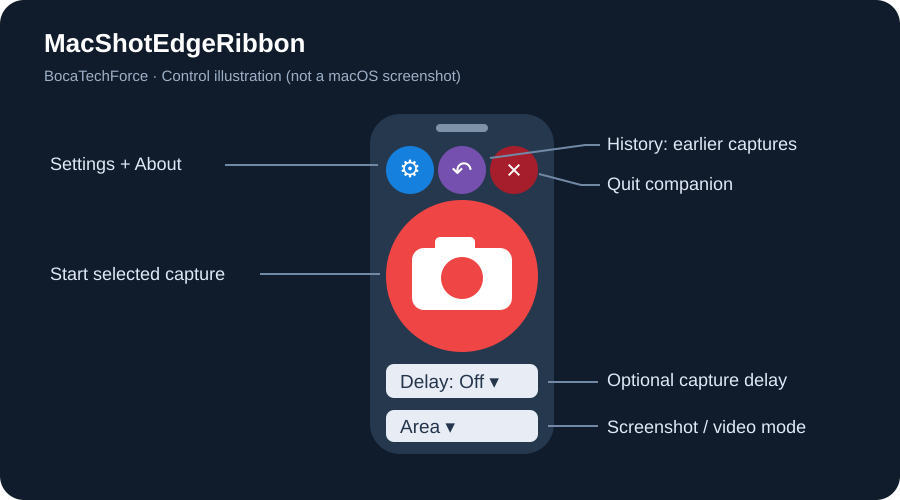
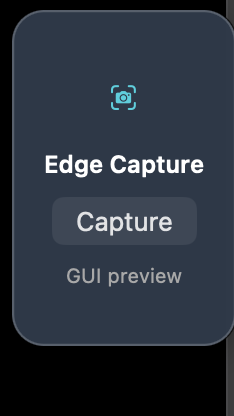

# MacShotEdgeRibbon

**A free floating capture ribbon for MacShot, by [BocaTechForce](https://www.bocatechforce.com).**  
IT. Simplified.

MacShotEdgeRibbon adds a small tab to the right edge of your Mac display.
Hover to expand it, start a capture, and let the ribbon hide automatically.
It is an independent companion, not an official MacShot release or fork.
MacShot must be installed separately.

> **MacShot is required.** This ribbon is a launcher, not a standalone screen
> capture or editing app. **[Install the original MacShot](https://macshot.io/)**
> ([official source and releases](https://github.com/sw33tLie/macshot)), launch
> it, and enable its `macshot://` URL scheme before using this companion.

## Visual guide



*Control illustration of the current layout, not a native macOS screenshot.*

<details>
<summary>Real screenshot of the original working prototype</summary>



*Owner-provided screenshot from the first GUI prototype. This shows the
project's starting point, not the latest appearance. The current ribbon has
compact colored icon controls and screenshot/video mode selectors.*

</details>


## Features

- Area, full-screen, and scrolling screenshot launchers.
- Area and full-screen video recording launchers.
- Purple History button to open MacShot's history.
- Optional 3-, 5-, or 10-second delay with Cancel.
- Draggable vertical position, remembered size and settings.
- Blue Settings, purple History, red Quit and a centered capture button.
- No companion menu-bar icon, account, subscription, or network service.
- BocaTechForce About dialog in the gear menu.

## Requirements

- macOS 12 or later for this companion; your MacShot version may require newer macOS.
- [MacShot](https://github.com/sw33tLie/macshot) installed, launched, and configured
  to enable its `macshot://` URL scheme.
- Apple Command Line Tools to compile (`xcode-select --install`).
  Full Xcode and a paid developer account are not required for a local build.

## Build and install

Download or clone this source, then open Terminal in its folder:

```bash
bash build.command
```

The script compiles Swift/AppKit, generates a blue icon, bundles license
notices, and ad-hoc signs `build/MacShotEdgeRibbon.app`. It opens Finder and
launches the app. To build without opening it, use:

```bash
bash build.command --no-launch
```

Quit an older running version before replacing it. Copy the built app into
Applications and launch that copy. Prebuilt notarized binaries are not
provided by this source package.

## Start at login

In System Settings → General → Login Items (or Login Items & Extensions),
add the Applications copy under Open at Login. Add MacShot or enable its own
startup setting too. Older macOS versions use Users & Groups → Login Items.
Remove old differently named ribbon entries to avoid duplicate launches.

## Use

Hover over the right-edge tab. Drag the top grip up/down to reposition it.
Select a mode below the camera; the delay selector is above the mode selector.
Click the red camera to launch the selected MacShot action.

- **History:** purple clock between gear and Quit; copy earlier images using MacShot.
- **Scrolling:** select the region and use MacShot's scrolling controls to finish.
- **Video:** select/confirm the region, configure recording in MacShot, start,
  and use MacShot's toolbar or menu-bar Stop control to finish.
- **Delay:** allows time to open a menu before screenshot selection starts.
  For video it delays opening recording setup, not the video start itself.
- **About:** gear → About MacShotEdgeRibbon.

MacShot owns screenshot/video capture, editing, history, and saving. Recording
settings and output folders are configured in MacShot, not in the ribbon.
See [troubleshooting](docs/TROUBLESHOOTING.md).

## Privacy and integration

The companion does not capture screen pixels, upload captures, or record
keystrokes. It temporarily observes mouse-down/up events and MacShot window
metadata to decide when to restore the tab. MacShot has its own permissions
and privacy policy. Opening the company website from About is optional.

See [architecture](docs/ARCHITECTURE.md) for the URL mapping and limitations.
This prototype currently targets the main display, not one ribbon per monitor.

## License and attribution

**Free and source-available, with no resale.** Personal use and internal
business use are permitted. Free redistribution of original and modified
versions requires retaining attribution, supplying source, and keeping the
same terms. Selling the app, paid redistribution, and paid bundling require
separate written permission. The license does not restrict your screenshots
or recordings. Read [LICENSE](LICENSE) for the actual terms.

This is a custom license, not an OSI-approved open-source license.
[MacShot](https://github.com/sw33tLie/macshot) is a separate project under its
own GPL-3.0 license; no MacShot source or binary is bundled here.
See [third-party notices](THIRD_PARTY_NOTICES.md).

## Project status and support

Version 0.17 packages the working personal prototype with branding and public
project documentation. Earlier builds were tested interactively by the owner
on a Mac; the 0.17 About/build changes still need a native Mac build and visual
check. This preparation environment is Linux and cannot verify AppKit behavior.
See [validation checklist](docs/VALIDATION.md) before distributing binaries.

Contributions: [CONTRIBUTING.md](CONTRIBUTING.md). Changes: [CHANGELOG.md](CHANGELOG.md).

Created and maintained by **BocaTechForce** · [bocatechforce.com](https://www.bocatechforce.com).
